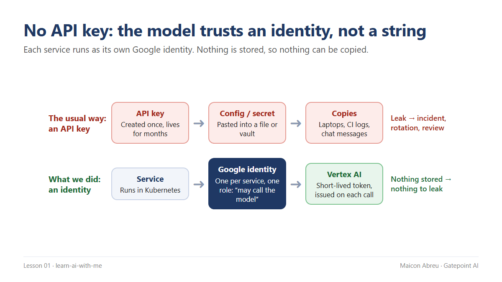

# 01 · No API keys

> **The idea:** don't give your AI services a key to the model. Give each one an **identity** that is allowed to call the model — and nothing else. Nothing stored means nothing to leak.



## The problem

Almost every AI tutorial starts the same way: *create an API key, paste it into a config file.* It works in five minutes, which is exactly why it survives into production.

A key is a password that never expires on its own. It gets copied — into a secret store, a developer's laptop, a CI log, a handover note, a chat message. Each copy is a way in. When one leaks, you have an incident, a rotation across every service that uses it, and a security review that lands in the middle of your delivery plan.

## The decision

On the last AI platform I worked on — Google Cloud, with Kubernetes for the services and Vertex AI for the models — **there was no API key**:

1. **Every service runs as its own Google identity** (on Kubernetes this is *Workload Identity Federation for GKE*).
2. **That identity is granted one role:** permission to call the model. Not the database, not the storage, not the other services.
3. **On each call, Google issues a short-lived token** to the running service. Nothing is written to a file, so nothing can be copied.
4. **Access is a line in the architecture document**, reviewable by security and auditable after the fact.

It wasn't free. When we started loading documents into the knowledge base, a default setting we had never touched still expected a key — and every upload failed. The fix was small. Finding it took longer, because the error message pointed at a key nobody should have had. The lesson: **an identity-only platform also needs a check that no component quietly expects a key.** That's what the example below does.

*Naming note: Google now presents Vertex AI as part of Gemini Enterprise Agent Platform; the identity model is the same.*

## The trade-off

| You gain | You give up |
|---|---|
| No secret to leak, rotate or forget | More identity and permission setup at the start |
| Access you can audit: who called the model, as whom | Local development needs its own setup (developers use their own login, not a shared key) |
| Least privilege by default — one service, one role | Vendor defaults that assume a key have to be found and changed |
| A shorter, calmer security review | Someone has to own the identity map as services are added |

For a project manager, this is a **before-the-first-prototype decision**. Prototypes become products. Retrofitting identity into a system that already works means touching every service, every pipeline and every runbook — and usually happens right after a leak.

## Try it

[`example/find_keys.py`](example/find_keys.py) — Python, standard library only, made-up data, no API key.

```bash
cd example
python find_keys.py
```

It scans [`sample-config/`](example/sample-config/) — three made-up services — and reports each one as:

- **KEY STORED** — `invoice-summary` has a key in its config *and* a copy pasted into its handover notes.
- **IDENTITY** — `policy-search` authenticates as its own identity. Nothing stored.
- **KEY EXPECTED** — `report-writer` uses an identity, but its document-loading section still asks for a key at runtime. This is the one that bites: it fails on a platform with no keys, and tempts someone to "just add one".

Point it at your own folder with `python find_keys.py <folder>` (read-only; secrets are masked in the output). It exits with code 1 when it finds a key, so it can gate a pipeline. For real projects, use a proper secret scanner as well — this script is a teaching stand-in.

*Tested with Python 3.12.10 on Windows, 16 Oct 2026.*

## Common mistakes

- **"It's only for the prototype."** The prototype is the first draft of production. Set up identity on day one, when it costs an afternoon.
- **One identity for everything.** A single shared service account gives every service the permissions of all of them. One service, one identity, one role.
- **Granting project-wide roles.** "Editor on the project" is a key with extra steps. Grant the narrowest role that works.
- **Downloading a service-account key file "to make it work".** That puts you back at square one — a long-lived secret in a file.
- **Trusting vendor defaults.** Search configs for settings that read a key from the environment. They fail quietly until the day someone fills them in.

## Go deeper

- [About Workload Identity Federation for GKE — Google Cloud](https://docs.cloud.google.com/kubernetes-engine/docs/concepts/workload-identity): how Kubernetes workloads get a Google identity without keys.
- [Authenticate to Google Cloud APIs from GKE workloads — Google Cloud](https://docs.cloud.google.com/kubernetes-engine/docs/how-to/workload-identity): the step-by-step setup your engineers will follow.
- [Best practices for using service accounts securely — Google Cloud](https://docs.cloud.google.com/iam/docs/best-practices-service-accounts): one identity per service, least privilege.
- [Best practices for managing service account keys — Google Cloud](https://docs.cloud.google.com/iam/docs/best-practices-for-managing-service-account-keys): why to avoid keys, and what to do if you can't.
- [How Application Default Credentials works — Google Cloud](https://docs.cloud.google.com/docs/authentication/application-default-credentials): how code finds its identity on a laptop and in production.
- [Secure AI Framework (SAIF) — Google](https://saif.google/): where identity fits in securing AI systems overall.

---

📣 LinkedIn post for this lesson: *link added after publishing* · Next: [02 · Governance is architecture](../02-governance-is-architecture/)
