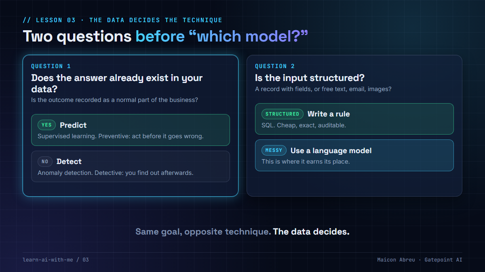

# 03 · The data decides the technique

> **The idea:** before choosing a model, ask two questions. *Does the answer already exist in your data?* And *is the input structured or genuinely messy?* The answers pick the technique for you.

## The problem

AI projects often start with the technology ("let's use a language model for this") and then look for a problem. The result is expensive systems that answer the wrong question, or that use AI where a simple rule would have been cheaper, faster and fully auditable.

## The two questions

### 1. Does the answer already exist? (Is there a *label*?)

A **label** is the outcome you want to predict, recorded as a normal by-product of the business.

| | No label | Label exists |
|---|---|---|
| Example I worked on | **Toll revenue leakage.** Nobody records "the reader quietly failed on Tuesday." | **Insurance claim denials.** Every past claim comes back with the insurer's verdict. |
| Question you *can* ask | "Is today unusual?" | "Will this claim be rejected?" |
| Technique | **Unsupervised** anomaly detection | **Supervised** prediction |
| What you get | **Detective:** you learn after the money is gone | **Preventive:** you fix it before it's submitted |

Same goal (stop losing revenue), opposite technique. The data decided.

### 2. Is the input structured or messy?

In the same healthcare project, the same business event arrived in two forms:

- In one country, insurers replied with **structured messages**, so plain **SQL rules** were enough: cheap, exact, auditable.
- In another, the reply arrived as **free-text email in two languages**. That's where a **language model** genuinely earned its place.

**Rule of thumb:** if the input is structured and the rule can be written down, write the rule. Use AI where the input really is messy and variable.

## The trade-off

Checking for the label first sometimes kills an exciting idea ("we can't predict that, we've never recorded the outcome"). That's the point. It's far cheaper to learn it in a workshop than after building a model with nothing to learn from. Sometimes the right first project is to **start recording the outcome**, so a predictive system becomes possible next year.

| Asking these questions first gets you | It costs you |
|---|---|
| The cheapest technique that answers the real question | Some ideas die in the workshop |
| A clear reason for every model in the system | A conversation with the business about what they actually record |
| Rules where rules work, so the AI budget goes where it's needed | A less exciting first demo |

## Try it on your own idea

This lesson is a decision guide, not code. Take one AI idea from your backlog and answer:

1. What exactly would the system predict or produce?
2. Where is that outcome recorded today? If nowhere, can we start recording it?
3. Is the input a structured record, or free text, images or audio?
4. Could a written rule handle most cases? If yes, start there and measure what's left.

If you answered "nowhere" to question 2 and "structured" to question 3, you probably need anomaly detection plus rules, not a language model.

## Common mistakes

- **Treating anomaly detection as prediction.** "Unusual" isn't the same as "wrong". It needs a human to investigate.
- **Using a language model on structured data** because it's fashionable. It's slower, costlier and harder to audit than SQL.
- **Forgetting the label is a business process.** If nobody records outcomes consistently, the model learns noise.
- **Building the predictor before checking the history.** A label that exists for six months of data won't train a model for seasonal behavior.

## Go deeper

- [Introduction to Machine Learning, MIT OpenCourseWare](https://ocw.mit.edu/courses/6-036-introduction-to-machine-learning-fall-2020/): supervised vs unsupervised learning, properly explained.
- [MIT 6.S191, Introduction to Deep Learning](https://introtodeeplearning.com/): modern AI in a few weeks of free lectures.
- [Practical Deep Learning for Coders, fast.ai](https://course.fast.ai/): if you want to train a model yourself.
- [Hugging Face Learn](https://huggingface.co/learn): free courses on applying language models.

---

📣 LinkedIn post: 3 Nov 2026 · Previous: [02 · Governance is architecture](../02-governance-is-architecture/) · Next: [04 · RAG for executives](../04-rag-for-executives/)
