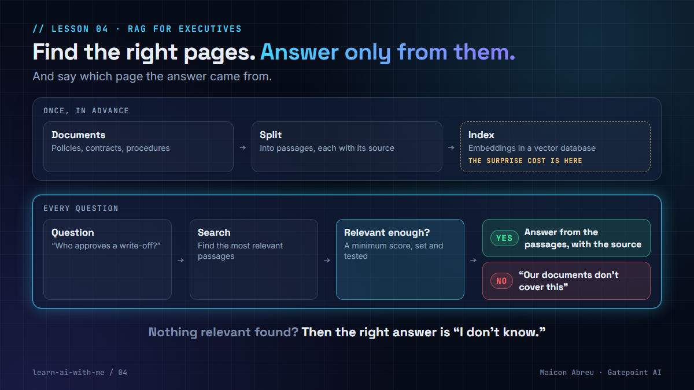

# 04 · RAG for executives

> **The idea:** Retrieval-Augmented Generation means *find the right pages first, then answer only from them — and say which page.*



## Explaining it in one breath

Imagine hiring a brilliant consultant who has never seen your company's documents. You don't make them read the whole library before every meeting. You hand them the three pages that matter and say: *"Answer from these — and tell me which page."*

That's RAG. The model doesn't "know" your policies; it reads the passages you retrieve for it, every time.

## How it works

**Preparing the library (indexing)** — done once, then kept up to date:
1. Split each document into small passages, remembering where each came from.
2. Turn each passage into a searchable form — real systems use *embeddings* (numbers that capture meaning), stored in a vector database such as PostgreSQL with pgvector.

**Answering a question:**
3. Search for the passages most relevant to the question.
4. **If nothing is relevant enough, stop and say "I don't know."**
5. Send the question plus the passages to the language model, with the instruction to answer only from them and cite the source.

## Three lessons from working on a RAG system over regulatory documents

1. **"I don't know" is a feature.** Without a deliberate minimum relevance score, the system will always find *something* and answer confidently from it.
2. **The citation is the product.** In a regulated business, an answer without a source is an opinion. People trust the system because they can click through and check.
3. **The surprise cost is preparing the library, not answering questions.** Splitting, enriching and embedding a large collection can cost more than a year of queries. Budget for indexing up front — and for re-indexing when documents change.

## The trade-off

| You gain | You give up |
|---|---|
| Answers grounded in your own, current documents | Quality depends entirely on finding the right passages |
| A source for every answer | Someone must own the document library and keep it current |
| No retraining when policies change — just re-index | An indexing cost that grows with the library |

## Try it

[`example/rag.py`](example/rag.py) — Python, standard library only, three short **fictional** policy documents, no API key.

```bash
cd example
python rag.py
```

It answers three questions **with a citation** — and declines the fourth (*"What is our policy on remote work?"*), because nothing in the documents covers it. It also prints the prompt a real system would send to a language model.

To keep it dependency-free, the example searches with simple keyword scoring (TF-IDF). Real systems use embeddings and often combine both — that's a later lesson.

*Tested with Python 3.12.10 on Windows, 14 Oct 2026.*

## Common mistakes

- **No minimum relevance score** — the system answers everything, including questions the documents don't cover.
- **Chunks cut mid-sentence or mid-table** — split on the document's own structure (sections, clauses).
- **Nobody owns the library** — outdated documents produce confident, outdated answers.
- **Measuring only the final answer** — test retrieval separately: did it find the right passage at all?

## Go deeper

- [Contextual Retrieval — Anthropic](https://www.anthropic.com/engineering/contextual-retrieval) — a measured technique for finding the right passages more often.
- [RAG infrastructure for generative AI — Google Cloud Architecture Center](https://docs.cloud.google.com/architecture/rag-capable-gen-ai-app-using-vertex-ai) — a reference architecture with AlloyDB for PostgreSQL.
- [pgvector](https://github.com/pgvector/pgvector) — vector search inside PostgreSQL.
- [DeepLearning.AI courses](https://www.deeplearning.ai/courses) — several short, free courses on building and evaluating RAG.
- [OWASP Top 10 for LLM applications](https://genai.owasp.org/llm-top-10/) — includes risks specific to retrieval (vector and embedding weaknesses).

---

📣 LinkedIn post: *link added after publishing* · Previous: [03](../03-the-data-decides-the-technique/)
