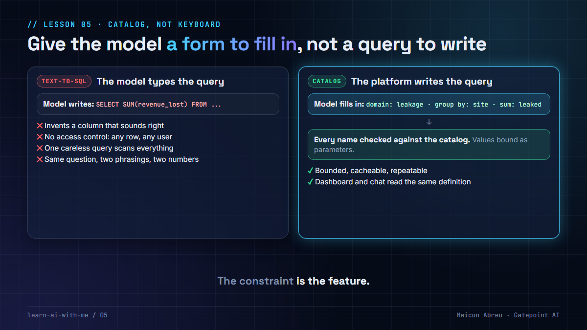

# 05 · Catalog, not keyboard

> **The idea:** don't let a language model write SQL against your data. Give it a **catalog** of what can be asked (domains, fields, business labels) and let the platform write the query.



## The problem

"Chat with your data" usually starts with a demo: give a model the database schema, ask a question in English, watch it write SQL. It's impressive for a week.

Then the problems arrive:

- The model **invents column names** that don't exist, or picks a real column that means something slightly different.
- There's **no access control**. If the model can write any query, a user can see any row.
- A careless query **scans billions of rows** and slows the warehouse for everyone.
- The query text changes every time, so results **can't be cached or reproduced**.
- Worst of all, **the same question phrased two ways returns two different numbers.** That destroys trust faster than a wrong answer does.

## The decision

On a revenue assurance platform I worked on, and again in [Argus](../argus/), the app I built, the model never wrote SQL:

1. **A catalog declares what can be asked.** Each domain (Argus calls them *lenses*) lists its fields, what each is called in business language, and which can be filtered, grouped or summed.
2. **The model fills in a form:** a domain, some fields, some filters. Nothing else.
3. **The platform checks every name against the catalog** and writes the SQL. Values are bound as parameters, never pasted into the query text.
4. **The dashboard reads the same catalog**, so the chart and the chatbot can't disagree about a number.

In Argus this is one small module, [`sqlbuilder.py`](../argus/libs/argus-core/argus_core/sqlbuilder.py), and it is the platform's whole injection surface. So it was the first thing I tested, and hard: 14 attack-shaped field names and hostile filter values, all rejected or bound safely.

## The trade-off

| You gain | You give up |
|---|---|
| Queries that are bounded, cacheable and repeatable | Someone has to define and maintain the catalog |
| Field-level access control, decided once | A question outside the catalog can't be answered until you add it |
| Business labels instead of column names | Less "magic" in the first demo |
| One number per question, everywhere | |

**The constraint is the feature.** For a system reporting on revenue, this trade is obviously right. Being able to say why, instead of reaching for the most autonomous option available, is what an AI delivery lead brings to the room.

## Try it

[`example/catalog_query.py`](example/catalog_query.py): Python, standard library only, made-up data in an in-memory SQLite database, no API key.

```bash
cd example
python catalog_query.py
```

It plays the model's part with five requests:

1. **A normal request** returns leakage by site, with the SQL the platform wrote and its parameters.
2. **The same question from the dashboard** produces exactly the same SQL and the same numbers.
3. **An invented column** (`revenue_lost`) is rejected: it isn't in the catalog.
4. **A field name carrying an injection attempt** is rejected for the same reason. It never reaches the database.
5. **A hostile filter value** is bound as data, so it matches nothing, and the table is still there afterwards.

*Tested with Python 3.12.10 on Windows, 28 Oct 2026.*

## Common mistakes

- **"We'll validate the SQL the model writes."** You'd be writing a SQL parser that has to win every time. It's simpler to never let the model write SQL.
- **Exposing every column "for flexibility".** Each field in the catalog is a decision. Start small and add fields when someone asks a real question.
- **A separate set of definitions for the dashboard.** Two definitions of "leakage" guarantee two numbers. One catalog, read by both.
- **Putting the field list in the prompt only.** A prompt is a request. The check has to live in code, where the query is built.

## Go deeper

- [OWASP Top 10 for LLM applications](https://genai.owasp.org/llm-top-10/): "excessive agency" and "prompt injection" are the risks a catalog closes.
- [SQL Injection Prevention Cheat Sheet, OWASP](https://cheatsheetseries.owasp.org/cheatsheets/SQL_Injection_Prevention_Cheat_Sheet.html): why values are bound as parameters and identifiers come from an allow-list.
- [Building effective agents, Anthropic](https://www.anthropic.com/engineering/building-effective-agents): designing tools a model can use well, with clear, narrow inputs.

---

📣 LinkedIn post: 17 Nov 2026 · Previous: [04 · RAG for executives](../04-rag-for-executives/) · Next: [06 · Two databases, two jobs](../06-two-databases-two-jobs/)
