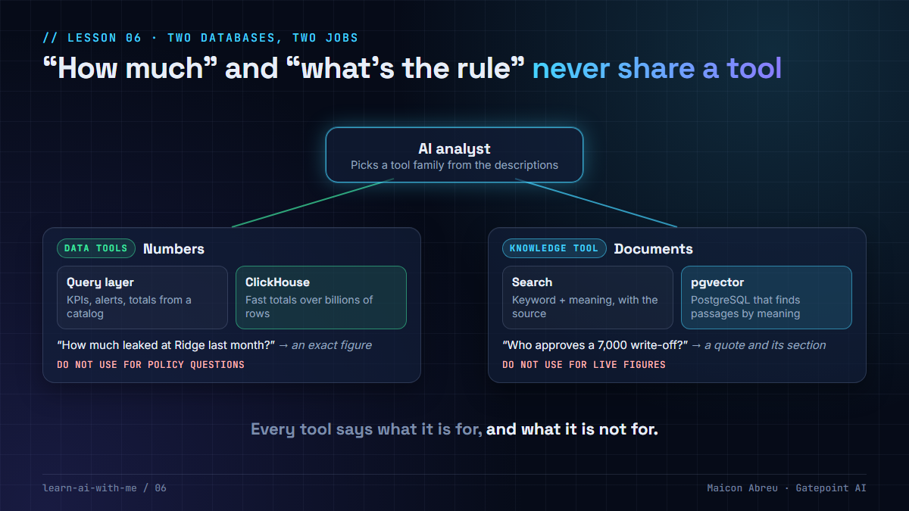

# 06 · Two databases, two jobs

> **The idea:** "how much leaked?" and "what does our policy say?" are different questions. Keep the numbers in an **analytics store**, keep the documents in a **knowledge store**, and give the AI a separate family of tools for each.



## The problem

An AI analyst for a finance team gets two kinds of question all day:

- **"How much did we lose at the Ridge site last month?"** The answer is a number. It has to be exact, computed over millions of rows, and the same every time someone asks.
- **"Who has to approve a write-off of 7,000?"** The answer is a sentence in a policy document, with its source.

Put both behind one tool and the model starts mixing them up. Ask a policy question and it answers from whatever numbers it can see. That's how you get a confident answer with no source, which in a regulated business is just an opinion.

## The decision

In [Argus](../argus/), the app I built, the two jobs live in two places, and the AI reaches them through two families of tools:

| | Analytics | Knowledge |
|---|---|---|
| **Holds** | Usage, billing and collection records | Policy documents, split into sections |
| **Database** | ClickHouse, built for fast totals over billions of rows | PostgreSQL with pgvector, built for "find the passage that means this" |
| **The AI reaches it through** | Data tools: KPIs, alerts, the query layer from [lesson 05](../05-catalog-not-keyboard/) | One knowledge tool: search the documents, return passages with their source |
| **Answers look like** | A number, computed by a query | A quote, with document and section |

**Every tool says when to use it and when not to.** In Argus the data tools say "Do NOT use for policy or process questions", and the knowledge tool says "Do NOT use for live figures". A model that isn't told the difference will answer a policy question from a stale number. The descriptions are in [`tools.py`](../argus/services/analyst/analyst/tools.py).

You can see the whole stack in Argus's [`docker-compose.yaml`](../argus/docker-compose.yaml): ClickHouse for analytics, PostgreSQL for the services' own records, a separate PostgreSQL with pgvector for knowledge, and Valkey as a cache. One command starts all four.

## The trade-off

| You gain | You give up |
|---|---|
| Each store does the job it's built for | More moving parts to run and back up |
| Numbers never come from a document, sources never come from a number | Two kinds of evaluation: query results and retrieval quality |
| Tools the model can tell apart | Questions that need both take two tool calls |

**Is it overkill for a small team?** Often, yes. If your data fits comfortably in PostgreSQL, pgvector can live in the same database and you still get the main benefit: **two separate tool families**. The separation that matters most is in the tools, not the servers.

## Try it

[`example/two_tool_families.py`](example/two_tool_families.py): Python, standard library only, made-up data, no API key.

```bash
cd example
python two_tool_families.py
```

It prints the tool descriptions a model would read, then routes five questions:

- **"How much" questions** go to the data tool and come back as exact figures.
- **"Who approves" questions** go to the knowledge tool and come back as a quote with its source.
- **A mixed question** ("Ridge wrote off 7,000 this month. Who approves that?") uses both.

Then it removes the knowledge tool and asks the policy questions again. With only numbers available, the answer is a list of amounts that says nothing about who approves anything.

A stand-in router plays the model, using the "use for" words. A real model reads the descriptions instead.

*Tested with Python 3.12.10 on Windows, 28 Oct 2026.*

## Common mistakes

- **One "search everything" tool.** The model can't tell a policy passage from a table row, and neither can the person reading the answer.
- **Tool descriptions that only say what a tool does.** Say what it must *not* be used for, too.
- **Putting numbers in the knowledge base.** A PDF of last quarter's figures becomes a second, stale source of truth.
- **Evaluating only the final answer.** Check that each question reached the right family of tools.

## Go deeper

- [pgvector](https://github.com/pgvector/pgvector): vector search inside PostgreSQL.
- [ClickHouse documentation](https://clickhouse.com/docs): the analytics database Argus uses.
- [Writing tools for agents, Anthropic](https://www.anthropic.com/engineering/writing-tools-for-agents): how to describe tools so a model picks the right one.
- [Function calling, Gemini API](https://ai.google.dev/gemini-api/docs/function-calling): how a model chooses between tools you declare.

---

📣 LinkedIn post: 24 Nov 2026 · Previous: [05 · Catalog, not keyboard](../05-catalog-not-keyboard/) · Next: [07 · Hybrid search](../07-hybrid-search/)
