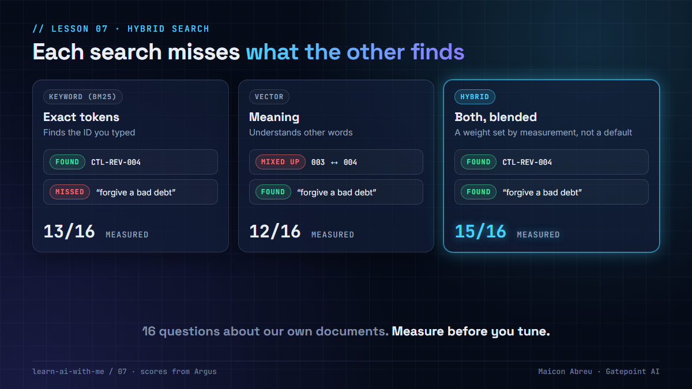

# 07 · Hybrid search

> **The idea:** keyword search finds exact IDs, vector search finds meaning, and each misses what the other finds. Blend them, and set the blend by **measuring on questions about your own documents**, not by trusting a default.



## The problem

Most RAG tutorials use **vector search** only: turn every passage into an embedding, turn the question into one, return the closest. It's very good at meaning. Ask "who signs off when we forgive a bad debt?" and it finds the write-off approval policy, even though none of those words appear in it.

Business documents are full of **exact tokens**: control IDs, clause numbers, product codes, statute references. To an embedding model, `CTL-REV-003` and `CTL-REV-004` look almost identical. Ask about one and you may get the other, delivered with full confidence and the wrong citation.

## The decision

**Run both searches and blend the scores.** Keyword search (BM25) catches the exact token, vector search catches the meaning, and a weight decides how much each counts.

The weight is the decision, and it depends on your documents:

- On a regulatory knowledge base I worked on, full of control IDs and statute numbers, keyword search beat embeddings on exact tokens, so the usual semantic-heavy default was turned around in favor of keywords.
- In [Argus](../argus/), the app I built, I measured before tuning: 16 questions over five policy documents, half naming an exact ID and half in plain English.

| Retriever | Exact-ID questions | Plain-English questions | All |
|---|---|---|---|
| Keyword only | **8/8** | 5/8 | 13/16 |
| Vector only | 5/8 | **7/8** | 12/16 |
| **Hybrid** | **8/8** | **7/8** | **15/16** |

Each retriever failed on a different kind of question, and the blend fixed both. A reranker, often added by default, made no difference on these questions, so it's switched off. The evaluation runs with one command and lives next to the code, so the next change gets measured too.

## The trade-off

| You gain | You give up |
|---|---|
| Exact IDs found exactly, plain questions understood | Two indexes to build and keep in step |
| Fewer confident answers with the wrong citation | A weight someone has to own and re-check |
| A number you can show when someone asks "how good is the search?" | An evaluation set to write and maintain |

For a project manager: **the evaluation set is the deliverable.** Twenty real questions with known right answers, written with the people who'll use the system, are worth more than any default setting. Without them, nobody can say whether a change made search better or worse.

## Try it

[`example/hybrid_search.py`](example/hybrid_search.py): Python, standard library only, four fictional documents, no API key.

```bash
cd example
python hybrid_search.py
```

It asks five questions, two naming a control ID and three in plain English, and runs each through keyword, vector and hybrid search. Then it prints the scorecard:

```
Retriever    Exact-ID questions    Plain-English      All
Keyword                    2/2             1/3      3/5
Vector                     1/2             3/3      4/5
Hybrid                     2/2             3/3      5/5
```

Real systems get "meaning" from an embedding model. To stay dependency-free, the script fakes one with a small concept map, which is enough to show the behavior: it understands that "bad debt" means write-off, and it can't tell `CTL-BILL-003` from `CTL-BILL-004`. The blend weight is 0.5, as a starting point. Change it and watch the scorecard.

*Tested with Python 3.12.10 on Windows, 28 Oct 2026.*

## Common mistakes

- **Trusting the default weight.** It was tuned on someone else's documents.
- **Measuring only the final answer.** Measure retrieval on its own: did the right passage come back at all?
- **An evaluation set with only one kind of question.** Include exact IDs, plain-English questions, and questions the documents don't answer.
- **Adding a reranker because everyone does.** Measure it. Here it added cost and nothing else.

## Go deeper

- [Contextual Retrieval, Anthropic](https://www.anthropic.com/engineering/contextual-retrieval): combines embeddings with BM25 and measures the improvement.
- [The Probabilistic Relevance Framework: BM25 and Beyond](https://www.staff.city.ac.uk/~sbrp622/papers/foundations_bm25_review.pdf): the original authors' explanation of BM25.
- [pgvector](https://github.com/pgvector/pgvector): vector search inside PostgreSQL, which Argus combines with PostgreSQL full-text search.
- [DeepLearning.AI courses](https://www.deeplearning.ai/courses): short courses on retrieval and evaluating RAG.

---

📣 LinkedIn post: 1 Dec 2026 · Previous: [06 · Two databases, two jobs](../06-two-databases-two-jobs/) · Next: [08 · Argus](../08-argus/)
