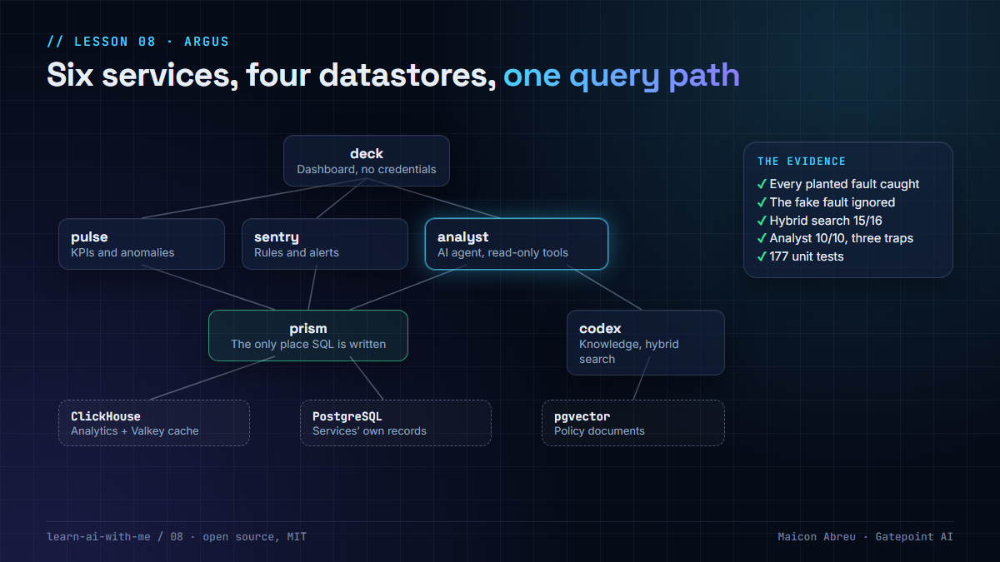

# 08 · Argus: inside the AI revenue-assurance app I built

> **The idea:** the lessons in this repo describe patterns. [Argus](../argus/) shows them running together in one app: usage data in, KPIs and leakage alerts out, and an AI analyst that explains them without ever computing a number itself.

📄 **The carousel:** [argus-carousel.pdf](argus-carousel.pdf), eight slides that walk through it.

## Why I built it

I spent 20 years in revenue assurance and fraud: finding money that should have been collected and wasn't. Argus is the system I wish I'd had. It takes the controls I've worked with for two decades and puts a language model on top, allowed to explain and never allowed to calculate.

v1 runs end to end on synthetic data and is published here as open source under the MIT license.

## How it is built

Six services over four datastores, started with one command.

| Service | Job |
|---|---|
| **prism** | The query layer. The only place SQL is written, from a catalog of declared fields |
| **pulse** | KPI engine: daily values, anomalies, a weekly-seasonal forecast |
| **sentry** | Rule engine: judges every site separately, suppresses systemic events, alerts close themselves |
| **codex** | Knowledge base: policy documents, local embeddings, hybrid search |
| **analyst** | The AI agent: read-only tools, declared denials, a number check on every answer |
| **deck** | The dashboard: pages are YAML, every figure comes from a service |

## Four rules, and the lesson behind each

| Rule | Lesson |
|---|---|
| **Everything queries through one layer.** No other service holds database credentials, so the dashboard and the chat can't disagree. | [05 · Catalog, not keyboard](../05-catalog-not-keyboard/) |
| **Data and knowledge are separate tool families.** "How much leaked" and "what does the policy say" never share a tool. | [06 · Two databases, two jobs](../06-two-databases-two-jobs/) |
| **The model never calculates.** Every figure comes from SQL or code, and every answer is checked against the data. | [09 · The AI never calculates](../09-ai-never-calculates/) |
| **Constraints live in the architecture, not the prompt.** The analyst can't run rules, edit alerts, write SQL, change config or browse the web. Each denial is declared in code with the failure it prevents. | [15 · Deny capabilities](../15-deny-capabilities/) |

## The evidence

A demo that says "it works" proves little. Argus carries its own proof:

- **Planted faults.** The test data has four faults on purpose, and one fake "fault" (every site dropping on a holiday) that the system must ignore. The acceptance gate checks every one, and fails if nothing ran.
- **Retrieval, measured.** Keyword 13/16, vector 12/16, hybrid 15/16 on its own questions. See [lesson 07](../07-hybrid-search/).
- **The analyst, on golden questions.** 10/10, including three traps: an off-topic question, a request to add numbers up, and a request for an action it isn't allowed to take.
- **177 unit tests** that run with no network and no key.

## What building it taught me

- **Averages hide the fault you're looking for.** Network-wide KPIs caught one of the four planted faults. Per-site rules caught all four.
- **The anomaly can teach the detector it's normal.** On day 3 of a 3-day fault, days 1 and 2 had already raised the baseline. The fixed rule still caught it. That's why rules sit under the statistics.
- **Unit tests don't replace running the real thing.** 114 tests passed while two queries failed against the real database engine.
- **Guard rails need tests too.** The number check once flagged a figure the user had typed in their own question.

## Try it

Argus needs Docker. The [Argus README](../argus/README.md) has the commands, and the [runbook](../argus/docs/RUNBOOK.md) covers setup and troubleshooting. It runs on a laptop with a free-tier language model key.

## Go deeper

- [Argus README](../argus/README.md): the full evidence, the limits, and how to run it.
- [Argus architecture](../argus/docs/ARCHITECTURE.md): the four rules in detail.
- [Building effective agents, Anthropic](https://www.anthropic.com/engineering/building-effective-agents): the case for simple, bounded agents, which Argus follows.

---

📣 LinkedIn post: 8 Dec 2026 · Previous: [07 · Hybrid search](../07-hybrid-search/) · Next: [09 · The AI never calculates](../09-ai-never-calculates/)
