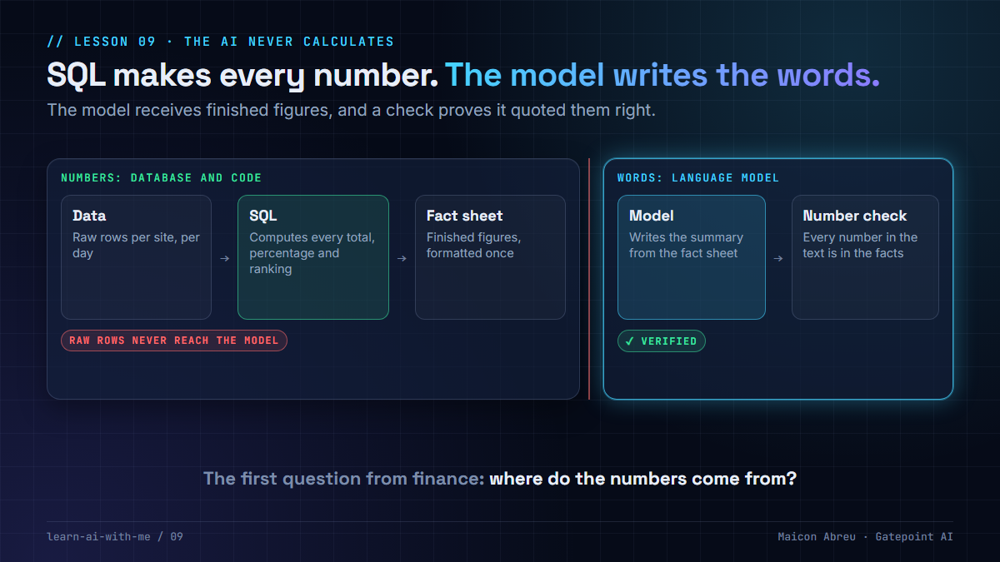

# 09 · The AI never calculates

> **The idea:** let SQL produce every number. Give the language model finished figures, ask it only to write the words around them, and check that it quoted them right.



## The problem

Executives love a written summary: *what changed, where, and what to look at first.* Language models write those summaries well. But they are unreliable at arithmetic. They can drop a row, round loosely, or invent a total that sounds right.

In a finance or operations report, a wrong number isn't a typo. It's the moment people stop trusting the system, and an AI nobody trusts is worth nothing, however clever it is.

## The decision

On the AI systems I've worked on, **the language model was never allowed to produce a number**:

1. **SQL (or a statistical model) computes every figure:** totals, percentages, rankings.
2. The figures are formatted once, into a small **fact sheet**.
3. The **language model receives only the fact sheet** and writes the paragraph.
4. **A checker confirms every number in the text appears in the fact sheet** before anyone sees it.

This isn't a prompt instruction like *"please don't calculate."* It's the **shape** of the system: the model never sees raw rows it could add up wrong.

## What building it myself added

Taking the arithmetic away from the model doesn't stop it misquoting a number it was handed. In [Argus](../argus/), the app I built, an alert read "Rating accuracy: ENTERPRISE was 52.8%", and the model wrote that "accuracy fell to 52.8%". 52.8% was the **error** rate. The model read our label the way most people would.

Two fixes came out of it:

- **Every value carries what it measures** ("error rate", not "accuracy"), so the sentence can't be read two ways.
- **The number check runs on every answer** in the [analyst service](../argus/services/analyst/analyst/verify.py), and the screen says whether every figure was found in the data.

The check needed tuning like any other control. It first flagged a figure the user had typed in their own question, and a date range written as "16–19 Oct". Both became tests. A guard rail that cries wolf gets ignored.

## The trade-off

| You gain | You give up |
|---|---|
| Numbers that are always correct and auditable | The model can't answer questions you didn't pre-compute |
| A summary finance will actually trust | Someone has to decide which facts the summary needs |
| Cheaper, faster model calls (tiny prompts) | A little more design work up front |

For a project manager, this is a **week-two decision**: one line in the architecture. In month nine, after people have seen a wrong number, it's a rewrite and a trust problem.

## Try it

[`example/report.py`](example/report.py): Python, standard library only, made-up data, no API key.

```bash
cd example
python report.py
```

It runs the same report two ways:

- **The right way:** SQL computes the facts, a stand-in model writes the summary, and the number check **passes**.
- **The wrong way:** the stand-in model is given raw rows and "does the maths", skipping a row the way real models sometimes do, and the number check **catches it**.

To use a real model, replace `stand_in_llm_writes_summary()` with a call to your provider, sending the prompt the script prints.

*Tested with Python 3.12.10 on Windows, 28 Oct 2026.*

## Common mistakes

- **"We told it in the prompt not to calculate."** Instructions are requests. If the model never receives raw rows, it can't do the arithmetic at all.
- **Formatting numbers in two places.** Round and format once, in the fact sheet, so the text and the dashboard match exactly.
- **Ambiguous labels.** "Accuracy: 52.8%" invites the wrong sentence. Name what the number measures.
- **Skipping the check.** A short number check is the cheapest evaluation you'll ever write, and it catches the failure that hurts most.

## Go deeper

- [Building effective agents, Anthropic](https://www.anthropic.com/engineering/building-effective-agents): why simple, predictable workflows often beat autonomous agents.
- [OWASP Top 10 for LLM applications](https://genai.owasp.org/llm-top-10/): see "misinformation" and "excessive agency".
- [MIT 6.S191, Introduction to Deep Learning](https://introtodeeplearning.com/): how language models work, and why arithmetic isn't their strength.
- [DeepLearning.AI courses](https://www.deeplearning.ai/courses): short courses on building and evaluating LLM applications.

---

📣 LinkedIn post: 15 Dec 2026 · Previous: [08 · Argus](../08-argus/) · Next: [10 · What broke in production](../10-what-broke-in-production/)
