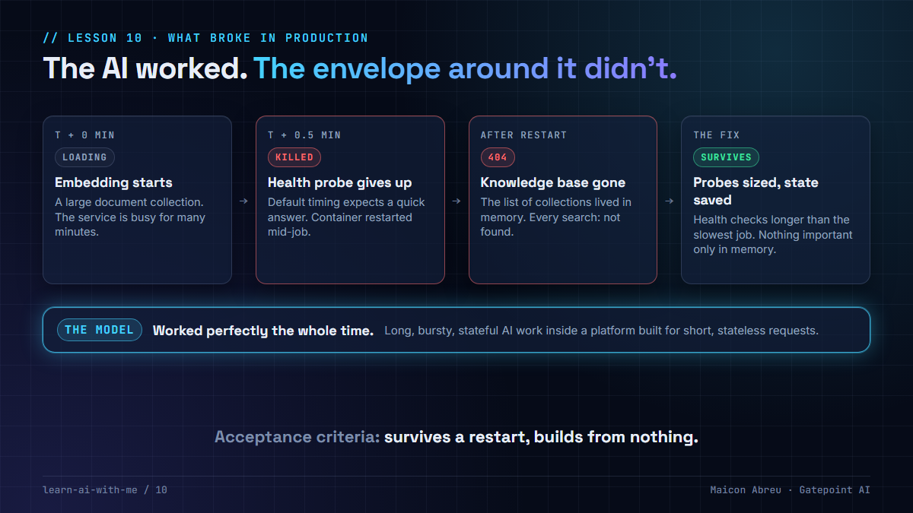

# 10 · What broke in production

> **The idea:** when an AI system fails in production, the model is rarely the problem. The **operational envelope** around it is: health checks, restarts, memory, start-up order. AI workloads are long, bursty and stateful, and the platforms they run on were built for short, stateless requests.



## The problem

Ask "what's hard about running AI in production?" and most answers are about model quality: hallucinations, accuracy, drift. Those matter. But the failures that took systems down, in what I've seen, were somewhere else.

Container platforms such as Kubernetes assume a service answers quickly, holds nothing important in memory, and can be restarted at any moment. A knowledge base being loaded breaks all three assumptions. Embedding a large document collection keeps the service busy for many minutes, and it builds up state as it goes.

## What happened

On a revenue assurance platform I worked on, the knowledge base was loading a large collection of regulatory documents:

1. **The health check killed it.** The platform's default probe expected a quick answer. Mid-embedding, the service was too busy to reply, so it was declared dead and restarted. The job never finished.
2. **The restart erased the knowledge base.** The list of loaded collections was held in memory, not saved. After every restart, every collection returned "not found" until someone registered it again by hand.

The model worked perfectly the whole time. The fix on the project was to relax the probe timings so long loads could finish. The deeper fix is to save the collection list, so a restart, which will happen, costs nothing.

**Building [Argus](../argus/) taught me the same thing on a laptop.** I deleted every data volume and rebuilt from nothing, a "clean-room" run. It found two bugs a warm system had hidden: services crashed on first start because their tables didn't exist yet (an automatic restart policy masked it), and a health check waited 30 seconds on a database not yet created, so the services behind it never started.

## The decision

Treat the envelope as part of the AI system, with its own acceptance criteria:

- **Health checks sized for the slowest real job**, not the platform default. Better still, move long jobs out of the request path into a background worker.
- **Nothing important only in memory.** If losing it on restart breaks the system, save it.
- **A clean-room run before every release.** Delete the data, rebuild from nothing, and check that everything comes up in the right order.
- **Restart on purpose during testing.** If the system can't survive a restart in test, it won't survive one in production.

## The trade-off

| You gain | You give up |
|---|---|
| A knowledge base that survives normal platform behavior | Time spent on unglamorous operational testing |
| Failures found in test, not by users | Slower releases while the clean-room run is added |
| A credible answer to "what breaks in production?" | |

For a project manager: **put "survives a restart" and "builds from nothing" in the acceptance criteria.** Nobody adds them later, because the system looks fine until the day it's restarted.

## Try it

[`example/envelope.py`](example/envelope.py): Python, standard library only, simulated time, no API key.

```bash
cd example
python envelope.py
```

It loads a knowledge base three ways:

1. **Defaults:** the probe kills the long embedding job, and the restart forgets the collection that had loaded fine.
2. **Probe relaxed only:** the embedding finishes, but the next routine restart forgets everything.
3. **Probe relaxed and the list saved to disk:** survives both.

*Tested with Python 3.12.10 on Windows, 28 Oct 2026.*

## A checklist for your next AI release

- [ ] What is the longest job this service runs? Is every health check longer than that?
- [ ] What does the service hold in memory? What happens to it on restart?
- [ ] Have we restarted every service mid-job, on purpose, in test?
- [ ] Have we built the whole system from empty data, in a clean environment?
- [ ] Do services start in the right order without someone watching?
- [ ] Is there an automatic restart policy hiding a crash loop?

## Common mistakes

- **Keeping platform defaults for AI services.** They were tuned for web requests that finish in under a second.
- **Testing only on a warm system.** Data left over from yesterday hides start-up bugs.
- **Treating "it restarted itself" as fine.** An automatic restart that hides a crash is a failure you haven't found yet.
- **Blaming the model first.** Check the envelope before you change the prompt.

## Go deeper

- [Configure liveness, readiness and startup probes, Kubernetes](https://kubernetes.io/docs/tasks/configure-pod-container/configure-liveness-readiness-startup-probes/): what each probe does, and the startup probe made for slow starts.
- [The Twelve-Factor App](https://12factor.net/): the "processes" and "disposability" factors explain why services shouldn't keep state in memory.
- [Site Reliability Engineering, Google](https://sre.google/sre-book/table-of-contents/): the free book on running systems in production.

---

📣 LinkedIn post: 5 Jan 2027 · Previous: [09 · The AI never calculates](../09-ai-never-calculates/) · Next: [11 · Verified means reconciled](../11-verified-means-reconciled/)
