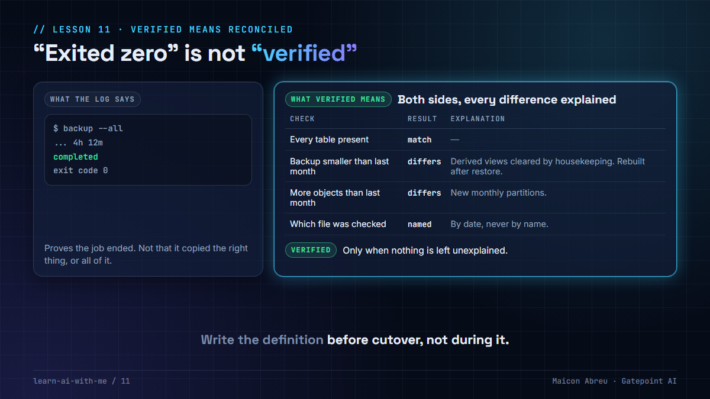

# 11 · Verified means reconciled

> **The idea:** "the script exited zero" proves the job ended. **Verified** means you counted what's on both sides, they match, and every difference has a written explanation. Agree that definition before the cutover, not during it.



## The problem

Data migrations end with a status update: *"backup completed, restore completed, verified."* Often "verified" means the job didn't error and the log says "completed". That's not verification. That's the absence of an error message.

Silent failures don't produce error messages. A job can copy the wrong file, skip a table, or restore everything except the permissions, and still exit zero.

## What I saw

On a database migration between two cloud providers that I worked on as an engineer:

**The new backup was smaller than last month's, but had more objects in it.** On a production migration, that's exactly the signal that should stop everything. Instead of assuming, the team reconciled it:

- Every table in production was in the backup. The counts matched exactly.
- The extra objects were **new monthly partitions**, created since the last backup.
- The missing size was **derived data**: summary views the client was clearing out as housekeeping. Their contents can be rebuilt after a restore, so losing them wasn't data loss.

Only then did anyone write "verified".

**And the quieter bug.** The scripts picked "the latest backup" by sorting folder names. Alphabetical order isn't date order: with last month's backup still on disk as the rollback copy, a date-style name would have sorted *before* it. The scripts would have uploaded and checked **last month's backup** and reported success. Nothing would have errored. We'd have found out at cutover.

## The decision

For a project manager, verification is an **acceptance criterion written before cutover**:

1. **Counts on both sides:** objects, rows or files, compared one by one, not in total.
2. **Sizes on both sides,** with a tolerance agreed in advance.
3. **Every difference explained in writing** and signed off. "Probably fine" is not an explanation.
4. **Name the thing you verified.** The report says which backup file, from which date, so the wrong one can't pass quietly.

## The trade-off

| You gain | You give up |
|---|---|
| A sign-off you can defend months later | Hours of reconciliation on cutover night |
| Silent failures found before they reach production | Investigating differences that turn out to be harmless |
| A clear stop rule for the go/no-go call | The comfort of a green status that means nothing |

The harmless differences are the point. Each one you explain is one you no longer have to wonder about at 2 a.m.

## Try it

[`example/reconcile.py`](example/reconcile.py): Python, standard library only, made-up manifests, no API key.

```bash
cd example
python reconcile.py
```

It walks through the steps:

1. **The backup job exits zero.** That proves nothing on its own.
2. **Production vs backup, object by object:** everything present, every size matching.
3. **The new backup is smaller than last month's, with more objects.** Before anyone investigates, two changes are unexplained and the answer is **VERIFIED: NO**. With the explanations written down (a new monthly partition, a derived view emptied by housekeeping), it's **VERIFIED: yes**.
4. **The quiet trap:** picking "the latest backup" by name chooses last month's.

*Tested with Python 3.12.10 on Windows, 28 Oct 2026.*

## Common mistakes

- **Comparing totals only.** One table missing and another doubled can produce the same total.
- **Treating "smaller" as "fine" because the job succeeded.** Smaller is a question to answer, not a result.
- **Picking files by name.** Pick by date, and print which file you picked.
- **Restoring the data but not the access.** Roles, permissions and default settings often live outside the main backup. Every byte can be restored and the application still fail to see its own tables.

## Go deeper

- [Site Reliability Engineering: Data Integrity, Google](https://sre.google/sre-book/data-integrity/): why backups are worth nothing until a restore is proven.
- [PostgreSQL: Backup and Restore](https://www.postgresql.org/docs/current/backup.html): what a dump includes, and what it doesn't.

---

📣 LinkedIn post: 12 Jan 2027 · Previous: [10 · What broke in production](../10-what-broke-in-production/) · Next: [13 · Autonomy is earned](../13-autonomy-is-earned/)
