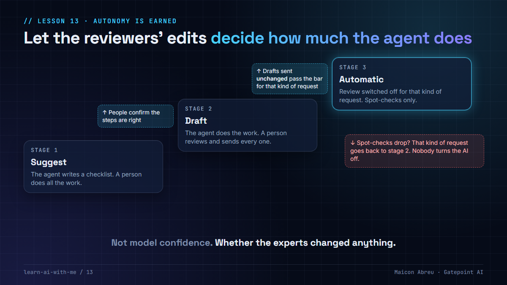

# 13 · Autonomy is earned

> **The idea:** don't decide up front how much an AI agent may do on its own. Let each kind of task **climb a ladder**, one stage at a time, on evidence the reviewers create just by doing their jobs: **how often they send the agent's work without changing anything.**



## The problem

Most AI projects decide how autonomous an agent will be at the start, in a design workshop. That's the moment when the team knows least about how well it works.

So the decision is made on hope or on fear. Too much autonomy, and the first public mistake shuts the project down. Too little, and the agent becomes an expensive suggestion box that nobody uses.

## The design

The best answer I've seen was a design for an agent handling customer correspondence in a healthcare business. It didn't decide the autonomy level. It built a **ladder** and let measurements decide:

| Stage | The agent | The person |
|---|---|---|
| **1 · Suggest** | Reads the request, classifies it, writes a checklist of steps | Does all the work |
| **2 · Draft** | Does the steps and drafts the reply, but submits nothing | Reviews, edits if needed, and sends every one |
| **3 · Automatic** | Sends on its own, for that kind of request only | Spot-checks |

**The promotion gate is the clever part.** A kind of request moves up a stage when the **share of drafts sent without edits** passes a threshold. Not model accuracy on a test set. Not a confidence score the model gives itself. Whether the people who know the job changed anything. It's measured automatically, as a by-product of people doing their work.

Three more details make it work:

- **The threshold is set per kind of request.** A routine address change can go automatic early. A payment dispute needs a much higher bar. Some, like a credit note, may never leave human review.
- **There's a path back down.** If spot-checks show quality dropping, that kind of request returns to stage 2. Nobody has to "turn the AI off".
- **Trust is built the right way round.** By the time review is switched off, the evidence belongs to the staff who generated it, not to a vendor's slide.

## The trade-off

| You gain | You give up |
|---|---|
| Autonomy decided on evidence, per kind of request | A slower path to "fully automatic" |
| A metric the business creates for free | Logging every edit reviewers make |
| A safe way back when quality drops | A policy someone must own: thresholds, minimum volumes, exclusions |
| Staff who trust the system because they trained it | The big-bang launch announcement |

For a project manager, **the ladder is a rollout plan, not just a design.** Stage 1 needs no risk sign-off. Stage 2 needs a review workflow. Stage 3 needs a threshold, agreed per scenario with the business before anyone sees the numbers.

## Try it

[`example/autonomy_ladder.py`](example/autonomy_ladder.py): Python, standard library only, made-up review history, no API key.

```bash
cd example
python autonomy_ladder.py
```

It applies the promotion policy to five review records:

- **Address change:** 97% sent unchanged, above its 90% bar, so it's **promoted** to automatic.
- **Copy of an invoice:** 100% so far, but only 25 reviewed. **No decision** until there's enough evidence.
- **Payment dispute:** 93%, below its 98% bar. **Stays** in review.
- **Credit note request:** 99%, and **stays** anyway. Policy says it always keeps a human reviewer.
- **Address change, a month later:** spot-checks drop to 74% after a form change, so it's **demoted** back to review.

*Tested with Python 3.12.10 on Windows, 28 Oct 2026.*

## Common mistakes

- **Promoting on model confidence.** The model rating its own work is not evidence.
- **One threshold for everything.** Risk differs by kind of request, so the bar should too.
- **No minimum volume.** Five perfect drafts are luck, not a track record.
- **No way back down.** Without demotion, the only response to a bad week is switching the whole thing off.
- **Not recording edits.** If the review tool doesn't capture whether the draft changed, you can't measure the one thing that matters.

## Go deeper

- [Building effective agents, Anthropic](https://www.anthropic.com/engineering/building-effective-agents): when to use agents, and why to keep humans in the loop at checkpoints.
- [NIST AI Risk Management Framework](https://www.nist.gov/itl/ai-risk-management-framework): "measure" and "manage" are the functions this ladder puts into practice.
- [People + AI Guidebook, Google PAIR](https://pair.withgoogle.com/guidebook/): designing for trust, feedback and control between people and AI.

---

📣 LinkedIn post: 26 Jan 2027 · Previous: [11 · Verified means reconciled](../11-verified-means-reconciled/) · Next: [15 · Deny capabilities](../15-deny-capabilities/)
