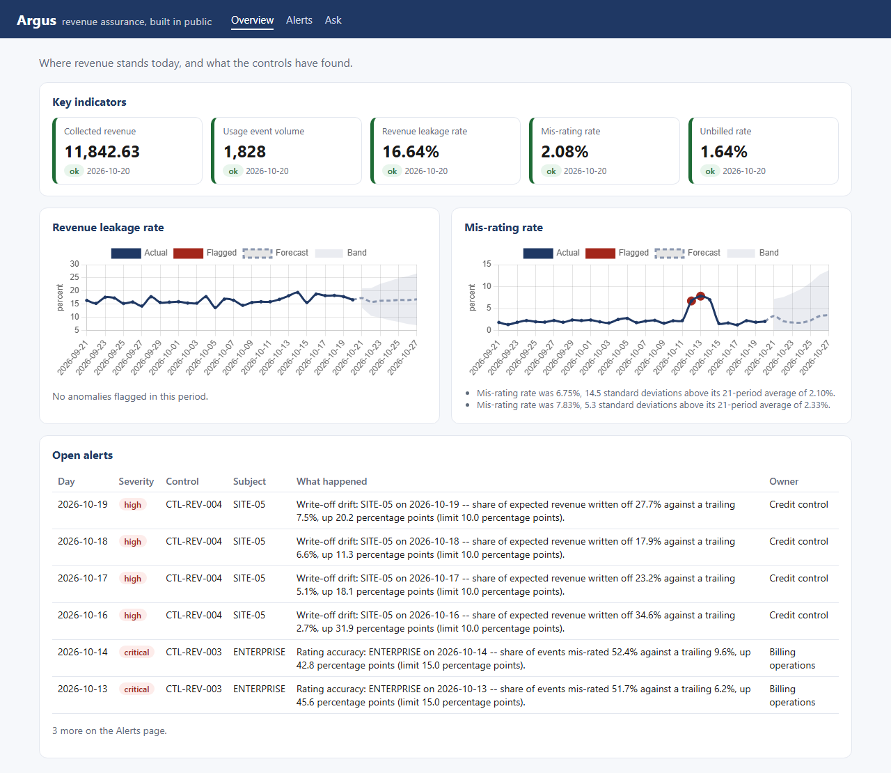

# Learn AI with me

**Practical lessons from delivering real AI systems — for project managers, delivery leads and anyone who has to make AI work in a business, not just in a demo.**

I'm [Maicon Abreu](https://www.linkedin.com/in/mbdabreu/), a Senior Technical Project Manager (PMP, Google Cloud Generative AI Leader) with 20+ years in revenue assurance, fraud and data & AI delivery. Every week I post one lesson on LinkedIn. This repo holds the full version: the idea, a diagram, a small example you can run, and the best free courses and documentation I've found.

The lessons are about **decisions and trade-offs** — where AI belongs, where it must not go, and how you'll know it works. You don't need to be an engineer to follow them. The examples are short and readable if you want to look under the hood.

## Lessons

| # | Lesson | The idea in one line | Example |
|---|---|---|---|
| 01 | [No API keys](01-no-api-keys/) | Give each AI service an identity, not a key: nothing stored, nothing to leak. | Python, no installs |
| 02 | [Governance is architecture](02-governance-is-architecture/) | The AI governance that matters is a handful of design decisions made early. | Reading guide |

## Coming next

A new lesson every Tuesday, the same day it goes out on LinkedIn.

| Date | Lesson |
|---|---|
| 3 Nov | The data decides the technique |
| 10 Nov | RAG for executives |
| 17 Nov | The model gets a catalog, not a keyboard |
| 24 Nov | Two databases, two jobs |
| 1 Dec | Hybrid search: keyword beat embeddings on exact IDs |
| 8 Dec | Argus: inside the AI revenue-assurance app I built |
| 15 Dec | The AI never calculates |
| | *Break for the holidays* |
| 5 Jan | What broke in production: the AI worked, the operating environment didn't |
| 12 Jan | Verified means reconciled, not "the script exited zero" |
| 19 Jan | This week's AI news through a delivery lens |
| 26 Jan | Autonomy is earned: measure how often reviewers change nothing |
| 2 Feb | 20 years chasing money that should have come in |
| 9 Feb | "We told the model not to" isn't a control. "The model cannot" is. |
| 16 Feb | This week's AI news through a delivery lens |

*Watch or star the repo to get each one when it lands.*

## Argus — the app behind the lessons

[`argus/`](argus/) is an AI revenue-assurance app I built and published here as open source: usage
data in, KPIs and leakage alerts out, and an AI analyst that explains them without ever computing a
number itself. The lessons describe a pattern; Argus shows it running.

**v1 runs end to end** in Docker on synthetic data: six services, four datastores, a dashboard,
and the evidence that it works — an acceptance gate over planted faults, a measured retrieval
evaluation, and golden questions for the AI analyst. [Start here](argus/README.md).

## How each lesson is organised

Every lesson folder has the same sections: **the idea** · **the problem** · **the decision and its trade-off** · **diagram** · **try it** · **common mistakes** · **go deeper** (official documentation and free courses).

## Further learning

[RESOURCES.md](RESOURCES.md) lists the free courses and official documentation I recommend — from MIT, Stanford, Google Cloud, DeepLearning.AI and others. Every link is checked when it's added.

Also by me: a free [study guide for the Google Cloud Generative AI Leader exam](https://github.com/maiconsystem/google-cloud-genai-leader-study-guide).

## A note on the examples

The examples are **teaching material**, written from scratch for these lessons. They use made-up data, run on a laptop and need no paid API keys. They show a pattern clearly; they are not production code. Real systems I describe in the lessons are referred to by industry only — no client names or confidential details.

## License

Code is under the [MIT License](LICENSE). Lesson text and diagrams are under [CC BY 4.0](LICENSE-CONTENT.md) — share and adapt them freely with credit.

---

Published by **Gatepoint AI** · Questions or ideas for a lesson? Open an issue or message me on [LinkedIn](https://www.linkedin.com/in/mbdabreu/).
