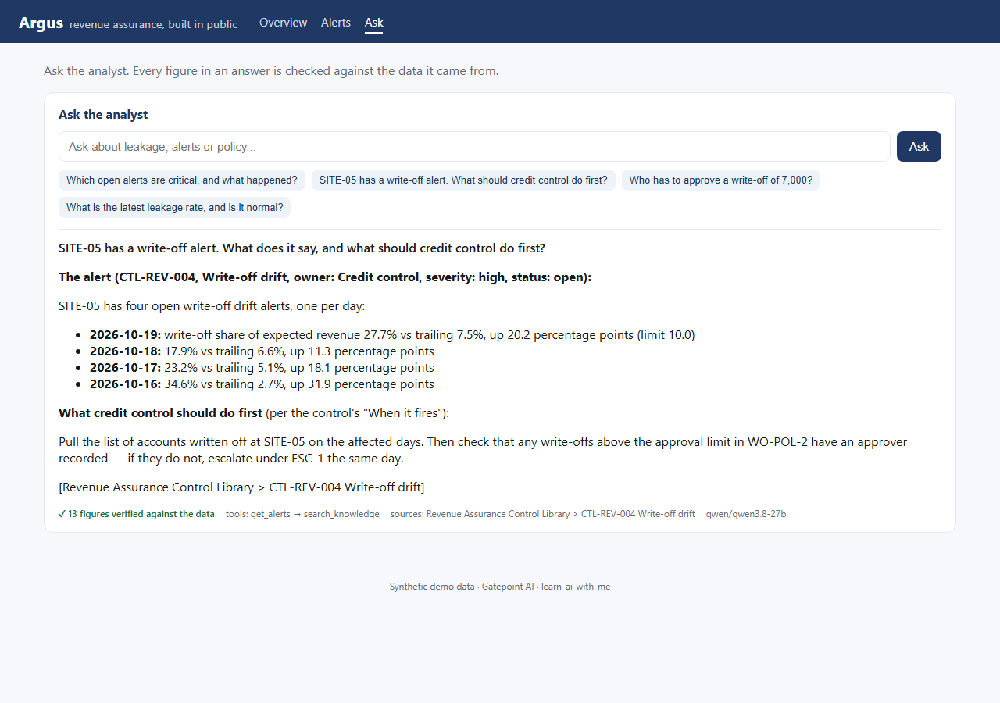

# Argus

An AI revenue-assurance platform, **built in public**. It ingests usage events, computes KPIs,
detects revenue leakage with configurable rules, and answers questions in plain English — grounded
in live data and a policy knowledge base, with every figure checked against its source.


> **v1 — October 2026.** All six services run end to end on synthetic data with planted faults.
> The acceptance gate passes (every planted fault caught, the negative control suppressed, nothing
> unexplained); hybrid search scores 15/16 on its own questions; the AI analyst passes ‹ANALYST›
> of its golden questions; 176 unit tests. Demo data only — see [Limits](#limits).

I'm [Maicon Abreu](https://www.linkedin.com/in/mbdabreu/) — 20 years in revenue assurance and fraud,
now delivering data and AI programs. Argus is the system I wish I'd had: the controls I've worked
with for two decades, rebuilt around a language model that is allowed to explain and never allowed
to calculate. Each idea is explained in a lesson in this repo — see the [lesson index](../README.md).

## Run it

You need Docker and, for the AI analyst only, a free [Groq](https://console.groq.com) API key.

```bash
cd argus
cp .env.example .env                         # set OPENAI_API_KEY -- only the analyst uses it
docker compose up -d --build                 # 4 datastores + 6 services
docker compose run --rm tools bootstrap      # migrate, seed, ingest, compute, run rules, acceptance gate
```

Open **<http://localhost:3000>**. From an empty machine, the build and bootstrap take ‹TIMING›.

The bootstrap ends with the acceptance gate:

```text
  PASS  feed_outage       2026-10-01  expect alert      PR-FEED-COMPLETENESS on SITE-03: open
  PASS  volume_spike      2026-10-08  expect alert      PR-VOLUME-SPIKE on SITE-06: open
  PASS  misrating         2026-10-11  expect alert      PR-RATING-ACCURACY on ENTERPRISE: open
  ...
  PASS  systemic_dip      2026-10-04  expect suppressed PR-FEED-COMPLETENESS: 8 breaches, 8 suppressed, 0 open
  No unexplained open alerts.
  10/10 checks passed (pass rate 1.00), 0 unexplained alerts
  GATE: PASS
```

Without Docker, the unit tests and the data generator run on any Python 3.12+:

```bash
cd argus && python -m venv .venv && . .venv/bin/activate   # Windows: .venv\Scripts\activate
pip install -e "libs/argus-core[test]" fastapi httpx
python -m pytest tests                                     # 176 tests, no network, no key
python datamodel/seed/generate.py --days 30 --dry-run      # the planted faults, no database
```

Operating notes and troubleshooting: [docs/RUNBOOK.md](docs/RUNBOOK.md).

## Ask it



Every answer shows the tools the analyst called, the passages it cited, and whether **every figure
in the answer was found in the data the tools returned**. A number the model worked out itself is
flagged to the reader, not hidden.

## How it is built

Six services over four datastores. Each is named for what it does.

| Service | Port | Responsibility |
|---|---|---|
| **prism** | 8000 | Query layer. Serves **lenses** — named SQL views with a closed list of fields. The only place SQL is generated. |
| **pulse** | 8001 | KPI engine. Daily values, breakdowns, direction-aware anomalies and a weekly-seasonal forecast. |
| **sentry** | 8002 | Rule engine. Judges every site and customer class separately; suppresses systemic events; alerts close themselves. |
| **analyst** | 8003 | AI agent. Seven read-only tools, six denied capabilities, a bounded loop and a number check. |
| **codex** | 8004 | Knowledge base. Heading-aware chunks, local embeddings, hybrid keyword + vector search. |
| **deck** | 3000 | Dashboard. Pages are YAML; every figure comes from a service API. |

The design rests on four rules — [docs/ARCHITECTURE.md](docs/ARCHITECTURE.md) has the detail:

1. **Everything queries through Prism.** No other service holds analytics credentials. One query
   path means one injection surface, one cache, one audit point — and the dashboard and the chat
   can't disagree about a number.
2. **Data and knowledge are separate tool families.** "How much leaked" comes from data tools;
   "what does the policy say" from the knowledge tool. Each tool says when *not* to use it.
3. **The model never calculates.** Figures are computed in SQL and deterministic Python. After the
   analyst answers, every figure is checked against the tool results.
4. **Constraints live in the architecture, not the prompt.** The analyst cannot run rules, edit
   alerts, write SQL, change config or browse the web. Each denial is declared in code with the
   failure it prevents.

## Evidence

### Synthetic data has faults on purpose

The seeder plants four documented faults **and one negative control**, and writes a manifest
the acceptance gate checks against:

| Planted | Shape | Must be |
|---|---|---|
| `feed_outage` | one site loses ~85% of a day's volume | alerted by `PR-FEED-COMPLETENESS` |
| `volume_spike` | one site doubles for a day | alerted by `PR-VOLUME-SPIKE` |
| `misrating` | one customer class mis-rated for 3 days | alerted by `PR-RATING-ACCURACY` |
| `collection_shift` | one site's write-off share jumps for 4 days | alerted by `PR-COLLECTION-DRIFT` |
| `systemic_dip` | **every** site loses ~70% on one day, like a public holiday | **suppressed**, not alerted |

A seeder that produced clean data would prove only that the stack starts — "no alerts" and
"detector broken" look identical. The gate fails closed: zero cases is a failure, every fault day
is checked, and an open alert the manifest cannot explain fails the run.

Two things the faults taught: network-wide KPIs caught **one** of the four (a site losing 85% of
its volume barely moves the network total), while per-site rules caught all four; and on day 3 of
the mis-rating fault, days 1–2 had already raised the statistical baseline — the fixed rule still
caught it. That is why both layers exist.

### Hybrid search, measured on our own documents

16 questions over five fictional policy documents, half naming an exact ID, half in plain English
(hit@3, `docker compose run --rm tools retrieval-eval`):

| Retriever | Exact-ID questions | Plain-English questions | All |
|---|---|---|---|
| Keyword only | **8/8** | 5/8 | 13/16 |
| Vector only | 5/8 | **7/8** | 12/16 |
| **Hybrid** | **8/8** | **7/8** | **15/16** |

Each retriever fails on a different kind of question; the blend fixes both. Embeddings put
`CTL-REV-003` and `CTL-REV-004` almost on top of each other — keyword search finds the exact token.
A cross-encoder reranker added nothing here, so it is off by default. Off-topic questions return no
passages, so the analyst can say "the documents don't cover that".

### The analyst, on golden questions

Ten questions with checks that don't depend on the day the data was seeded
(`docker compose run --rm tools analyst-eval`): routing to the right tool family, citing the right
section, every figure verified — and three traps: an off-topic question, a request to add numbers
up, and a request for an action it is denied.

‹ANALYST_TABLE›

## The field whitelist

A lens declares its fields. `argus_core.sqlbuilder` resolves **every** identifier through that list
and binds every value as a parameter. There is no path from a request string to a SQL identifier.
It is the platform's whole injection surface, so it is tested first and hard: 14 identifier-shaped
attack payloads, hostile filter values proven bound not inlined, both dialects covered.

## What's in the folder

| Path | What it is |
|---|---|
| `config/` | Everything the services do, as YAML: lenses, KPIs, rules, knowledge collections and documents, dashboard pages, evaluation questions |
| `libs/argus-core/` | Shared core: settings, clients, config schemas, the SQL compiler |
| `services/` | The six services, one folder each |
| `datamodel/` | Migrations, the seeder, the acceptance gate, evaluations, the `tools` image |
| `tests/unit/` | 176 tests — no network, no key |
| `docs/` | Architecture, runbook, screenshots |

## Limits

v1 is a working demo, not a product:

- **Synthetic data only.** Eight fictional sites, 30 days; the policy documents are fictional.
- **One LLM provider path.** Any OpenAI-compatible endpoint works (Groq by default, with a fallback
  model when the free tier throttles). A native Claude client and a constrained mode for small
  local models are not built yet.
- **Free-tier pacing.** Groq's free tier allows 8,000 tokens a minute; a multi-step question can
  take a minute when the tier is busy.
- **Local only.** No authentication; ports bind to `127.0.0.1`. Not for a shared network as is.

## Why "Argus"

Argus Panoptes was the hundred-eyed watchman who never slept with every eye at once. Revenue
assurance is the same job: watch a large surface continuously and notice the one thing that changed.

## License

Code under the [MIT License](../LICENSE). All data in this folder is synthetic.

---

Published by **Gatepoint AI** · Follow the build on [LinkedIn](https://www.linkedin.com/in/mbdabreu/).
